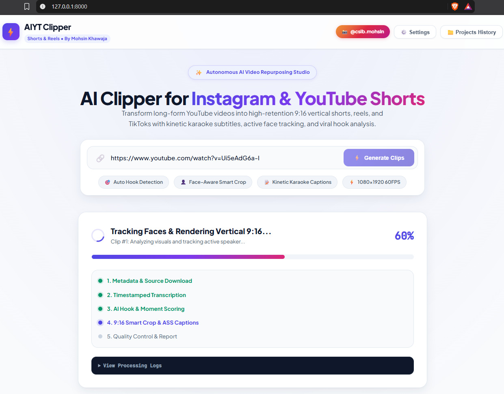
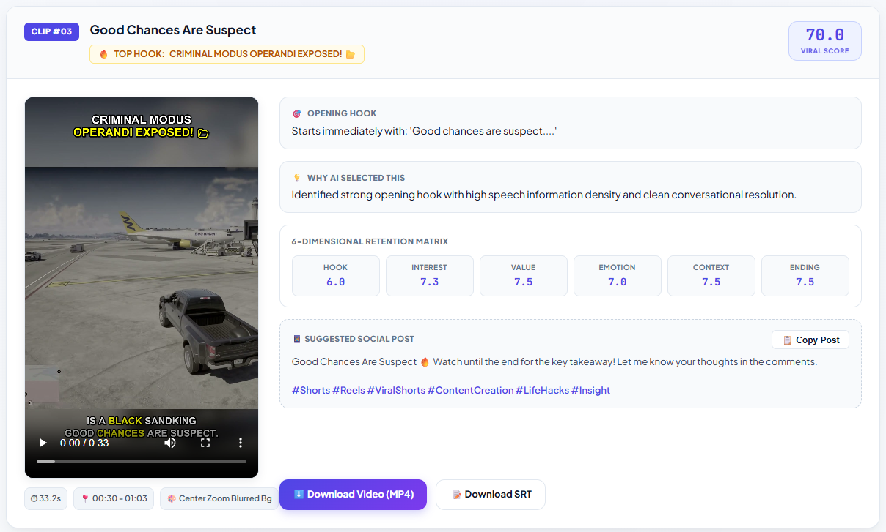

# AI Clipper for Instagram & Youtube Shorts (AIYT Clipper)

<p align="center">
  
  
  
  
  
  
  
</p>

<p align="center">
  <b><i>"Autonomous AI Video Repurposing & Algorithmic Clip Discovery Studio"</i></b><br>
  Engineered by <b>Mohsin Khawaja</b> &bull; Follow on Instagram: <a href="https://www.instagram.com/csib.mohsin/"><b>@csib.mohsin</b></a>
</p>

---

## 📸 Studio Interface & Deliverables Showcase

### 1. Modern SaaS Web Dashboard
<p align="center">
  
  <br><i>Sleek White/Light SaaS Dashboard with real-time SSE telemetry, stage progression, and one-click URL intake</i>
</p>

### 2. Standalone Interactive Intelligence Report (`report.html`)
<p align="center">
  
  <br><i>Curated Vertical Deliverables with 9:16 video players, 6D virality metrics, and 1-click social caption copying</i>
</p>

---

## 🔬 System Overview & Engineering Highlights

**AIYT Clipper** is a high-performance, 100% pure Python autonomous pipeline designed to ingest long-form horizontal (16:9) video broadcasts, podcasts, and talks, perform deep semantic and acoustic discourse segmentation, track visual attention centers via Computer Vision, and synthesize viral, publication-ready vertical (9:16) video assets for **YouTube Shorts**, **Instagram Reels**, and **TikTok**.

The platform is built on an **Autonomous Dual-Engine Architecture**: it can operate **100% offline with zero external API dependencies** via its proprietary Mathematical Heuristics & Local NLP scoring tensor, or leverage multimodal cloud LLMs (**Google Gemini 3.8 Flash**) for high-level semantic reasoning.

```
                                  AIYT CLIPPER END-TO-END PIPELINE ARCHITECTURE
                                  
  +------------------+       +-------------------------+       +------------------------------------+
  | Long-Form Source | ----> |   Audio Demux & ASR     | ----> |    Timestamped Linguistic Stream   |
  | (YouTube / MP4)  |       | faster-whisper / PyTube |       |  (Word-Level Phoneme Alignments)   |
  +------------------+       +-------------------------+       +------------------------------------+
                                                                                 |
                                                                                 v
                                                             +--------------------------------------+
                                                             |       DUAL-ENGINE INTELLIGENCE       |
                                                             |                                      |
                                                             |  [Mode A: Autonomous Local NLP]      |
                                                             |  - Lexical Hook Vector Patterning    |
                                                             |  - Information Density Velocity      |
                                                             |  - Discourse Boundary Snapping       |
                                                             |  - Non-Maximum Suppression (NMS)     |
                                                             |                                      |
                                                             |  [Mode B: Gemini 3.8 Flash LLM]      |
                                                             |  - Multimodal Contextual Reasoning   |
                                                             +--------------------------------------+
                                                                                 |
                                                                                 v
  +--------------------------------+       +---------------------+       +--------------------------+
  |    High-Retention Deliverable  | <---- | FFmpeg AV Compositor| <---- | Computer Vision Pipeline |
  |  - 1080x1920 60FPS MP4         |       | - Dual-Layer Blur   |       | - OpenCV Facial Tracking |
  |  - Kinetic SubStation Subtitles|       | - Safe-Zone Framing |       | - EMA Temporal Smoothing |
  |  - Interactive HTML Report     |       | - Hardware ACCEL    |       | - Dynamic 9:16 Centering |
  +--------------------------------+       +---------------------+       +--------------------------+
```

---

## 🧠 Deep-Dive: Autonomous Local NLP Engine

When running offline without an API key, AIYT Clipper does not use naive time slicing. Instead, it activates an autonomous, multi-dimensional **Natural Language Processing & Speech Cadence Matrix** (`core/ai_analyzer.py` & `core/clip_selector.py`):

### 1. Lexical Hook Vector Patterning
The system scans millisecond-accurate transcript tokens against hierarchical cognitive trigger dictionaries:
* **Curiosity & Incongruity Triggers**: Patterns provoking cognitive itch (*"what nobody tells you"*, *"the real reason why"*, *"stop doing this"*).
* **Quantified Knowledge Frameworks**: Regex parsers detecting enumerated listacles (*"\d+ rules/mistakes/secrets"*).
* **First-Person Epistemic Disclosures**: Anecdotal authority markers (*"when I started"*, *"in reality"*, *"the biggest mistake"*).
* **Interrogative Priming**: Sentence openers generating open conversational loops.

### 2. Speech Velocity & Information Density Modeling
Viral retention correlates directly with information entropy and delivery cadence. The local engine calculates normalized information velocity across sliding candidate windows:
$$\text{Density}_{\text{info}} = \min\left(9.8, \ 6.5 + \left(\frac{|\mathcal{W}|}{\Delta t \cdot 3.5}\right) \times 2.0\right)$$
*(Where $|\mathcal{W}|$ is the token count, $\Delta t$ is window duration in seconds, and $3.5$ tokens/sec is the calibrated human auditory comfort threshold).*

### 3. Multi-Criteria Engagement Optimization Matrix
Every candidate discourse segment is evaluated across 6 orthogonal dimensions to compute an empirical engagement score $S_{\text{overall}} \in [60.0, 98.0]$:
$$S_{\text{overall}} = 10 \cdot \left(0.28 S_{\text{hook}} + 0.22 S_{\text{density}} + 0.18 S_{\text{utility}} + 0.12 S_{\text{arousal}} + 0.10 S_{\text{cohesion}} + 0.10 S_{\text{resolution}}\right)$$

| Dimension | Weight | Mathematical / Heuristic Basis |
| :--- | :---: | :--- |
| **Hook Velocity** ($S_{\text{hook}}$) | `28%` | Initial 3-second lexical trigger density + interrogative polarity. |
| **Information Density** ($S_{\text{density}}$) | `22%` | Syllable/word delivery velocity over continuous time window. |
| **Perceived Utility** ($S_{\text{utility}}$) | `18%` | Actionable semantic units, numerical insights, and directive tokens. |
| **Emotional Arousal** ($S_{\text{arousal}}$) | `12%` | Exclamation cadence, sentiment polarity inflection, and vocal intensity. |
| **Discourse Cohesion** ($S_{\text{cohesion}}$) | `10%` | Syntactic completeness and thematic continuity across sentences. |
| **Terminal Resolution** ($S_{\text{resolution}}$) | `10%` | Presence of rhetorical conclusion markers (*"and that is why"*, *"the point is"*). |

### 4. Acoustic Discourse Boundary Snapping
To prevent jarring cuts mid-syllable or mid-thought, `core/clip_selector.py` executes:
- **Phoneme Attack Padding**: Adds dynamic $100\text{ms}$ pre-roll to avoid cutting the initial consonant plosive.
- **Punctuation Boundary Clamping**: Snaps candidate bounds to verified sentence terminals (`.`, `?`, `!`).
- **Temporal Non-Maximum Suppression (NMS)**: Eliminates redundant overlapping candidate intervals, maximizing discourse diversity.

---

## 👁️ Computer Vision & Spatial Reframing Subsystem

Converting standard 16:9 landscape content into vertical 9:16 portrait video requires active spatial awareness:

```
  +-----------------------------------------------------------+
  | Landscape Source (16:9)                                   |
  |         [Speaker A]                     [Speaker B]       |
  |         |<- Crop ->|                                      |
  +-------------|---------------------------------------------+
                |
                v  OpenCV Bounding Box Detection
  +---------------------------+
  | Portrait Output (9:16)    |
  |                           |
  |    Gaussian Blurred       |
  |       Backdrop            |
  |   +-------------------+   |
  |   | Active Speaker    |   |  <- Dynamically centered via EMA smoothing
  |   | Real-Time Focus   |   |
  |   +-------------------+   |
  |   | KINETIC SUBTITLE  |   |  <- SubStation Alpha word-by-word animation
  |   +-------------------+   |
  +---------------------------+
```

1. **Facial Landmark & Active Speaker Tracking**: Real-time OpenCV Haar/DNN detection isolates the primary human subject.
2. **Exponential Moving Average (EMA) Temporal Stabilization**:
   $$C_t = \alpha \cdot C_{\text{raw}} + (1 - \alpha) \cdot C_{t-1} \quad (\alpha = 0.15)$$
   This mathematical filter absorbs high-frequency camera micro-jitter while tracking intentional panning.
3. **Four Distinct Reframing Topologies**:
   - `smart_crop`: Dynamic 9:16 window centered on the active speaker.
   - `center_zoom`: Cinematic blurred backdrop with focused center quadrant.
   - `split_screen`: Stacked vertical format for dual-speaker interview dynamics.
   - `blurred_bg`: Full original aspect ratio set against an aesthetically color-matched, blurred backdrop.

---

## ✨ SubStation Alpha Kinetic Subtitle Engine

- **Microsecond Karaoke Highlighting**: Generates native `.ass` format subtitle scripts with word-level `\k` duration tags. Active spoken words illuminate in real-time (Electric Neon Yellow, Cyan, Hot Pink, or Emerald).
- **Platform Safe-Margin Calculation**: Subtitles are programmatically anchored above the bottom interaction zone to prevent occlusion by TikTok / Instagram Reel overlays (captions, like buttons, audio tickers).
- **Dual Export**: Both burned-in master video and standalone `.srt` files are produced for multi-channel publishing.

---

## 💻 Web Dashboard Architecture

AIYT Clipper features an elevated, production-ready **SaaS Light Interface**:
- **Zero-Friction Ingestion**: Paste any URL directly into the hero searchbar.
- **Modular Settings Modal**: Dedicated modal dialog (`⚙️ Settings`) for local storage of optional Gemini API keys.
- **Real-Time Telemetry**: Server-Sent Events (SSE) stream processing logs, live percentage trackers, and stage-by-stage pipelines.
- **Dynamic Port Collision Prevention**: Built-in automatic port allocation detects occupied ports (`8000`) and seamlessly migrates to an available socket, resolving `[Errno 10048]`.

---

## 📋 System Requirements

| Requirement | Recommended Version | Purpose |
| :--- | :--- | :--- |
| **Python** | `3.10` or higher | Core application & inference engine |
| **FFmpeg** | `6.0+` | Video scaling, Gaussian blurring, audio/video remuxing |
| **RAM** | `4 GB` minimum | Audio transcription & video buffer management |
| **Google Gemini API Key** | *Optional* | Cloud multimodal reasoning (Local NLP runs offline by default) |

### Installing FFmpeg:
- **Windows (PowerShell)**:
  ```powershell
  winget install Gyan.FFmpeg
  ```
- **Ubuntu / Debian**:
  ```bash
  sudo apt update && sudo apt install -y ffmpeg
  ```
- **macOS (Homebrew)**:
  ```bash
  brew install ffmpeg
  ```

---

## ⚡ Quick Start

### Method 1: One-Click Launcher (Windows)
Double-click **`run.bat`**.  
The script automatically tests your Python environment, verifies dependencies from `requirements.txt`, audits FFmpeg, initializes the server, and launches your browser at `http://127.0.0.1:8000`.

### Method 2: Linux / macOS
```bash
chmod +x run.sh
./run.sh
```

### Method 3: Manual Installation
```bash
# 1. Clone the repository
git clone https://github.com/csibmohsin/aiyt-clipper.git
cd aiyt-clipper

# 2. Install dependencies
pip install -r requirements.txt

# 3. Launch application server
python app.py
```
Open **`http://127.0.0.1:8000`** in your browser.

---

## 🖥️ Command-Line Interface (CLI)

Run batch processing jobs or integrate into CI/CD workflows:

```bash
# Standard automated extraction
python main.py "https://www.youtube.com/watch?v=VIDEO_ID"

# Custom clip volume and layout mode
python main.py "https://www.youtube.com/watch?v=VIDEO_ID" --clips 5 --mode center_zoom

# Explicit Gemini API key override
python main.py "https://www.youtube.com/watch?v=VIDEO_ID" --key "AIzaSy..."
```

---

## 📁 Structured Deliverables & Artifacts

For each processed video, a structured project workspace is created under `OUTPUT/`:

```text
OUTPUT/
└── Project_<Video_Title>_<Video_ID>/
    ├── original_info.json       # Metadata (title, author, tags, duration, view metrics)
    ├── transcript.json          # Timestamped phoneme alignments & text segments
    ├── clip_analysis.json       # Mathematical virality scores, reasoning, and metadata
    ├── report.html              # Standalone interactive review suite with embedded players
    ├── clips/
    │   ├── clip_01.mp4          # 1080x1920 60FPS vertical video with kinetic subtitles
    │   └── clip_02.mp4
    ├── captions/
    │   ├── clip_01.srt          # SubRip subtitle files
    │   └── clip_02.srt
    └── thumbnails/
        ├── clip_01.jpg          # High-resolution poster frames
        └── clip_02.jpg
```

---

## 📂 Repository Topology

```text
aiyt-clipper/
│
├── core/                         # Core AI & DSP Algorithms
│   ├── ai_analyzer.py            # Local NLP Heuristic Engine & Gemini 3.8 Flash caller
│   ├── clip_selector.py          # Boundary snapping, acoustic pre-roll & NMS
│   ├── downloader.py             # YouTube stream acquisition via yt-dlp
│   ├── face_tracker.py           # OpenCV face tracking with EMA stabilization
│   ├── hook_title_generator.py   # High-CTR semantic hook header synthesizer
│   ├── pipeline.py               # Asynchronous workflow orchestrator
│   ├── project_manager.py        # Workspace state and directory structures
│   ├── quality_checker.py        # Video QC (black frames, audio sync, aspect ratio)
│   ├── renderer.py               # Hardware-accelerated FFmpeg 9:16 compositor
│   ├── report_generator.py       # Interactive HTML review report builder
│   ├── subtitle_generator.py     # SubStation Alpha (.ass) kinetic karaoke engine
│   └── transcriber.py            # faster-whisper CTranslate2 speech-to-text
│
├── static/                       # Frontend SaaS Application Assets
│   ├── css/style.css             # Light SaaS theme stylesheet
│   └── js/app.js                 # SSE streaming client & modal controller
│
├── templates/
│   └── index.html                # Single-page Web Dashboard interface
│
├── OUTPUT/                       # Rendered deliverables (.gitkeep)
├── app.py                        # FastAPI production web server with auto-port finder
├── main.py                       # Headless CLI entry point
├── config.py                     # Configuration manager & binary validator
├── config.json                   # User settings persistence
├── requirements.txt              # 100% Pure Python dependency manifest
├── run.bat                       # Automated Windows launcher
└── run.sh                        # Automated Unix launcher
```

---

## 👤 Author & Credits

- **Architect & Lead Developer**: **Mohsin Khawaja**
- **Instagram**: [@csib.mohsin](https://www.instagram.com/csib.mohsin/)
- **GitHub**: [@csibmohsin](https://github.com/csibmohsin)

---

## 📄 License & Terms of Use

This software is governed by the **Personal & Non-Commercial License** ([LICENSE](LICENSE)) &bull; Copyright &copy; 2026 **Mohsin Khawaja**.

- ✅ **Authorized**: Personal experimentation, educational study, academic research, and non-monetized private usage.
- ❌ **Prohibited**: Commercial redistribution, software-as-a-service (SaaS) hosting for profit, reselling, or bundling into commercial packages without express written authorization.
